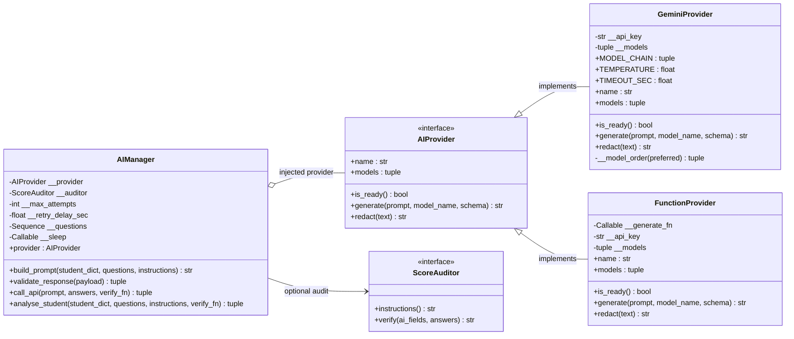

# Phase 2: Object-oriented AI Manager refactor

This document describes the AI subsystem only. The **complete Phase 2 OOP architecture** is documented in [PHASE2_ENGINEERING_NOTES.md](PHASE2_ENGINEERING_NOTES.md), with all production classes and methods in [UML_ALL_CLASSES.puml](UML_ALL_CLASSES.puml) and the core relationship diagram in [UML_CORE.puml](UML_CORE.puml). The IO, Logic and Data managers and the Flask controller have now also been converted to injected OOP services.

## Class diagram (matches the refactored code)



**Relationship justification:** `AIManager` receives an existing provider instance in its constructor; it does not create or destroy that object's lifecycle, so this is aggregation. The optional scoring auditor is an association: the Logic layer independently owns the scoring algorithm. The provider and auditor abstractions are abstract base classes (`ABC`). `FunctionProvider` is a compatibility adapter used by the old mock callbacks, not a fake success path in production.

**One class per file:** `AIManager` is in `ai_manager.py`, `AIProvider` in `ai/ai_provider.py`, `GeminiProvider` in `ai/gemini_provider.py`, `FunctionProvider` in `ai/function_provider.py`, and `ScoreAuditor` in `ai/score_auditor.py`.

## Runtime pipeline

1. `WebController` constructs an `AIManager` through `_ai_for_request`; it injects a `GeminiProvider` for real requests, or `FunctionProvider` for offline tests. `CheckinService.process_checkin` calls the manager directly.
2. `AIManager.build_prompt()` sends only the eleven answer fields and survey version. The student ID and reflection are excluded.
3. `AIManager.call_api()` calls the injected provider's `generate()`, supplying the unchanged JSON schema. `GeminiProvider` sends Gemini the original structured-JSON configuration, `temperature=0.0`, timeout and disabled SDK retries.
4. `AIManager.validate_response()` unwraps the raw text, then `ResponseContract` runs one `ResponseValidator` per field (score, items, choices, lists, reasoning). The Gemini JSON schema is built from those same validators. If provided, `ScoreAuditor.verify()` checks the arithmetic and category **without replacing** Gemini's result. Provider exceptions are classified by `ErrorClassifier`.
5. A successful reply is marked `source="gemini"` to preserve the existing Logic and Data contract. Otherwise, `AIManager` returns a structured error and no completed AI result.

## Error handling matrix

| Case | Behaviour | Result code |
|---|---|---|
| No Gemini API key | Stop before generating | `missing_api_key` |
| Timeout | Retry same model once if within call cap, then try next model | `timeout` if final failure is a timeout |
| HTTP 429/quota | Move to next model without repeating same model | `rate_limited` if every tried model was rate-limited |
| Bad JSON, missing or invalid fields | Retry once per model within four-call cap | `invalid_response` if final failure is invalid data |
| Logic auditor rejects AI score | Treat as invalid response; no fabricated scoring fallback | `invalid_response` |
| Other provider or network error | Move to next model, stop after call cap | `unavailable` or `retries_exhausted` |
| Empty model list | Do not call the provider | `unavailable` |

**Limit:** no more than `MAX_TOTAL_CALLS=4` calls per check-in. No source code calls a live model during offline tests.

## SOL (SOLID) justification

- **SRP:** `GeminiProvider` owns vendor-specific SDK calls and credential redaction; `AIManager` owns prompt, validation, retry policy and AI workflow; `StressScorer` in Logic owns the stress formula.
- **OCP:** new provider implementations can implement `AIProvider` without rewriting the retry or validation loop in `AIManager`.
- **LSP:** injected concrete `AIProvider` instances support the same `models`, `is_ready`, `generate` and `redact` contract. The new tests exercise both `GeminiProvider` (mock SDK) and `FakeProvider` (offline).

## Usage

```python
from ai_manager import AIManager
from ai.gemini_provider import GeminiProvider
from logic.stress_scorer import StressScorer

manager = AIManager(GeminiProvider(), auditor=StressScorer())
ok, enriched_record, error = manager.analyse_student(validated_record)
```

Existing `ai_manager.build_prompt`, `validate_ai_response`, `call_gemini`, `call_api`, `parse_response` and `analyse_student` functions remain for compatibility. Their orchestration and prompt/validation work now delegate to the OOP service. The `FunctionProvider` adapter preserves legacy `generate_fn(prompt, api_key, model_name)` tests without requiring a live key.

## Testing / reproducibility

From the project root, use Python 3.12 or newer:

```bash
python -m pip install -r requirements.txt
python -m unittest discover -s tests -v
```

The dedicated refactor tests run without installing Flask or Gemini SDK:

```bash
python -m unittest discover -s tests -p 'test_ai_manager_oop.py' -v
```

The complete test suite needs the listed Flask and Google SDK dependencies; HTTP integration, a Docker run and a live Gemini request still require verification in the submission environment. See the full Phase 2 engineering notes for the other manager refactors and current evidence.
